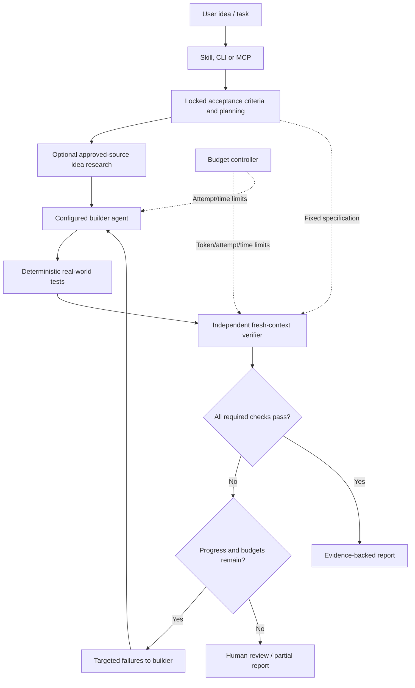

# Olyder

**Build. Challenge. Verify.**  ·  [GitHub](https://github.com/Ratnadeep-2007/Olyder)

**Build with an agent. Verify with evidence. Repair only what's failing.**

Olyder is a free, open-source, **verification-driven execution layer** for coding agents. It combines a portable agent skill, a Python CLI, an optional independent LLM reviewer, a bounded correction loop, and evidence-based reports. No model subscription is needed for deterministic tests.

> **Status: v0.1.0 public-development beta.** Real executable core and tests; not a production security sandbox, not autonomous general web research, and not a guarantee of correctness. See [limitations](#security--limitations).

## What it does

1. **Lock acceptance criteria** as explicit file, command, HTTP or browser checks.
2. **Plan** tasks from criteria. Optional AI planning only with explicit consent and quota limits.
3. **Research ideas** from explicitly approved HTTPS source URLs. AI feasibility summaries are optional and must be treated as hypotheses, not proof of market demand.
4. **Build** using your configured coding-agent CLI, only when explicitly permitted.
5. **Verify independently** with observable tests; optional fresh LLM review sees requirements and test results, **never the builder's conversation or reasoning**.
6. **Repair and retry** with targeted failure feedback, a hard attempt/time budget, and a measurable-progress stop.
7. **Report** JSON, Markdown and a self-contained HTML file with pass/fail metrics, declared-check execution coverage, evidence, status, scope and budget.

## Quick start

Requires Python 3.11+.

```bash
python -m pip install -e .
cd examples/demo-app
olyder plan
olyder verify --allow-exec
```

Open `.olyder/report.html` in a browser. This example passes its two declared checks and makes **no AI calls**.

For your own repository:

```bash
cd path/to/your/project
olyder init
olyder install-skill --target both --project .
# Review and customize olyder.json; especially its executable commands.
olyder plan
olyder verify --allow-exec
```

The installer intentionally does not automatically run build tools, install browsers, or call models.

## Autonomous builder → verifier loop

In `olyder.json` configure a builder command as an **argument array**, never a shell expression:

```json
{
  "goal": "Login with valid credentials and reject invalid passwords",
  "checks": [
    {"id":"smoke-tests","type":"command","argv":["python","-m","pytest","tests/test_auth.py"],"timeout":60}
  ],
  "builder":{"argv":["opencode","run","{prompt}"]},
  "sources":[],
  "limits":{"max_iterations":3,"max_tokens":30000,"max_seconds":600}
}
```

Start the autonomous loop **only after reviewing the builder and test commands**:

```bash
olyder run --allow-exec --execute-builder
```

This executes the configured external coding-agent CLI, which may modify files and invoke additional tools. The builder's own model calls are **not tracked or controlled** by Olyder in v0.1. Do not run it outside an OS-enforced sandbox when code, prompts, or agents are untrusted. The acceptance spec file hash is locked, but its file bytes are not protected against a malicious process.

Without `--execute-builder`, `olyder run` is a verify-only cycle that does not modify code. Without `--allow-exec`, command, HTTP and browser checks are blocked. **Blocked means not verified, not passed.**

## Independent verifier: optional model call

The test results stand independently of an LLM. For a fresh LLM critic on each verification pass:

```bash
# Fill values locally, never commit a .env with real credentials
export OLYDER_MODEL='your-model-id'
export OLYDER_API_KEY='your-api-key'
export OLYDER_BASE_URL='https://your-openai-compatible-endpoint/v1'
olyder verify --allow-exec --ai
```

On Windows PowerShell use `$env:OLYDER_MODEL="..."` etc. OpenAI-compatible models differ in API behavior; one model integration is implemented, not certified across all providers. The verifier gets the goal, acceptance IDs/types, bounded test output and results, **not builder chats, plans, or hidden chain-of-thought**. Its concerns can require review but never override an observed test failure.

### Quota-aware execution

- Deterministic tests use **zero model tokens**.
- `--ai` is opt-in, and each verifier/planner request gets fresh bounded context.
- The local `max_tokens` budget limits estimated prompt+response tokens for Olyder's **own** API requests. It is **not** a read of your provider's remaining subscription quota, and it does not meter external builder-agent requests.
- If the provider returns token usage, Olyder records it; otherwise it conservatively charges the reserved estimate.
- Retries have strict iteration and overall time limits; repeated identical failures stop the loop.
- Full regression checks run for each iteration in v0.1 rather than reusing potentially stale pass results. Selective re-testing will be introduced only when impact analysis can establish sound coverage.

## Scenario types

| Type | Purpose | Example |
|---|---|---|
| `file` | Presence and textual assertions inside workspace | `{"type":"file","id":"readme","path":"README.md","contains":"Install"}` |
| `command` | Unit/integration tests, compile or lint | `{"type":"command","id":"unit","argv":["python","-m","pytest"],"timeout":90}` |
| `http` | Read-only status/content GET | `{"type":"http","id":"health","url":"http://localhost:8080/health","status":200}` |
| `browser` | Real browser scenarios (optional Playwright) | `{"type":"browser","id":"login","url":"http://localhost:3000","steps":[{"action":"click","selector":"#login"},{"action":"expect_text","text":"Welcome"}]}` |

Browser tests require `python -m pip install -e '.[browser]'` and `python -m playwright install chromium`. Supported actions: `navigate`, `click`, `fill`, `expect_text`, `expect_url`. They run only against explicitly configured URLs; automated action sequences can still have side effects in the target app.

### Idea validation and real-world external evidence

Add explicitly approved source URLs:

```json
"sources": ["https://example.org/official-documentation"]
```

Then run `olyder idea --allow-network` to record source excerpts and hashes. Use `--ai` as well to request a **source-constrained feasibility assessment**. Merely retrieving a website does not validate an idea, prove market demand, or make a claim true. Source material is untrusted and should be cross-checked.

## MCP and agent-skill distribution

```bash
olyder mcp --workspace /absolute/path/to/project
```

MCP exposes `olyder_plan` and `olyder_verify` with file-only checks, no subprocesses and no network access. `olyder install-skill --target both --project PATH` copies the packaged skill into Claude and `.agents` skill directories and refuses to overwrite without `--force`. Configure this as a local stdio server in a compatible client. The supplied [SKILL.md](skills/olyder/SKILL.md) can be installed under `.claude/skills/olyder/` or `.agents/skills/olyder/` in supported coding-agent workflows; other clients can use the CLI directly. No IDE plugin is required.

## Architecture



## Real-world scenario examples

See [scenario examples and measurable outcomes](docs/EXAMPLES.md), including staging checkout, ML prediction, and AI-agent workflows. The included demo is deliberately small so the repository's checks can be reproduced without a model account.

## Code review and release hardening

See [the source review and outstanding security gaps](docs/CODE_REVIEW.md). This is a direct source review; CodeRabbit integration can be added to GitHub pull requests separately.

## Development

```bash
python -m pip install -e '.[dev]'
python -m pytest -q
```

CI tests Python 3.11 and 3.13 on Ubuntu and Windows. Project includes a cross-platform example, typed public inputs, no mandatory runtime dependencies, strict JSON specification validation and escaped HTML report generation.

## Security & limitations

- **No OS-level sandboxing yet.** A user-chosen workspace is *not* a containment boundary for subprocesses. Commands and AI coding agents may read/write outside it if their OS privileges permit. Run in a VM, container or properly configured OS sandbox. Git worktrees are not security boundaries.
- External builder CLIs can use their own networks, credentials, model subscriptions and tools. Olyder's local budget cannot cap those third-party operations.
- AI prompts can leak test-result snippets to a configured provider; test logs may contain secrets. Simple output redaction is not comprehensive. Don't enable `--ai` for sensitive logs without sanitization.
- HTTP and browser checks have network effects and URL redirects. Use only audited specifications against trusted services; no SSRF protection is claimed.
- Model verdicts are fallible. Passing declared checks is **not** complete product validation, security certification, or proof of business viability.
- No automatic acceptance-criteria discovery or automatic real-market research from arbitrary search queries in this release.
- An attacker with workspace write access may modify the test infrastructure itself; isolation of the builder/verifier requires separate runtime credentials and permissions.

## Roadmap

1. **OS-level isolation adapters** (Docker/WSL2/Linux namespaces, Windows sandbox), deny-by-default network and secrets policies.
2. **Provider-aware rate limits and full builder usage accounting** via supported agent telemetry rather than guesses.
3. **Dependency-aware test selection, coverage gates, cross-model verifier adapters**, and evaluation benchmarks.
4. Richer scenario exploration, accessibility/performance metrics, approved external evidence connectors, and CI/PR annotations.

## License

Apache License 2.0. Contributions and reproducible bug reports welcome.
