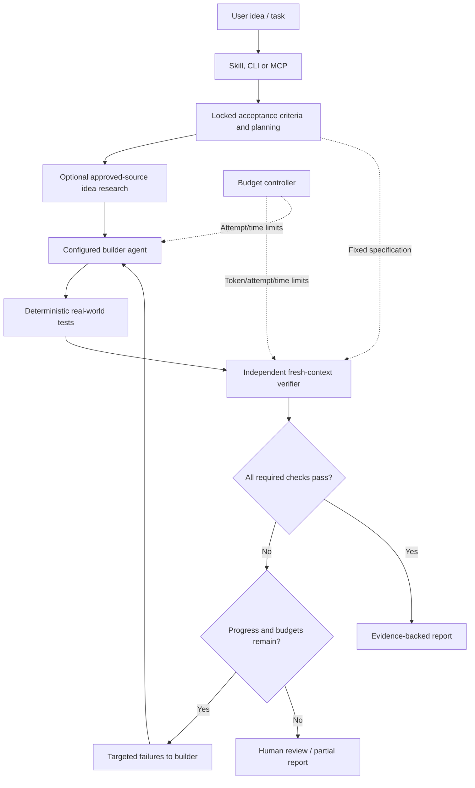

# Olyder

**Build. Challenge. Verify.**  ·  [GitHub](https://github.com/Ratnadeep-2007/Olyder)

**Build with an agent. Verify with evidence. Repair only what's failing.**

Olyder is a free, open-source, **verification-driven execution layer** for coding agents. It combines a portable agent skill, a Python CLI, an optional independent LLM reviewer, a bounded correction loop, and evidence-based reports. No model subscription is needed for deterministic tests.

> **Status: PyPI beta release candidate 0.5.0b1 (not yet published).** Tested CLI/SDK foundation and experimental protocol integrations; not a production security sandbox, not autonomous general web research, not a provider hard quota and not a guarantee of correctness. See [limitations](#security--limitations).

## What it does

1. **Lock acceptance criteria** as explicit file, command, HTTP or browser checks.
2. **Plan** tasks from criteria. Optional AI planning only with explicit consent and quota limits.
3. **Research ideas** from explicitly approved HTTPS source URLs. AI feasibility summaries are optional and must be treated as hypotheses, not proof of market demand.
4. **Build** using your configured coding-agent CLI, only when explicitly permitted.
5. **Verify independently** with observable tests; optional fresh LLM review sees requirements and test results, **never the builder's conversation or reasoning**.
6. **Repair and retry** with targeted failure feedback, bounded attempts, an overall fail-closed deadline check, and a measurable-progress stop.
7. **Report** JSON, Markdown and a self-contained HTML file with pass/fail metrics, declared-check execution coverage, evidence, status, scope and budget.

## Experimental ACP editor integration

Olyder can run as a **read-only ACP v1 agent** for compatible editors using an
optional dependency. This is a transport for deterministic Olyder tools,
not an autonomous conversational coding model or a verified ACP v2 implementation.

```bash
python -m pip install -e '.[acp]'
olyder acp --workspace /absolute/path/to/project
```

Send `plan`, `verify`, `status`, or `help` from the ACP client. The editor
cannot add MCP servers, select a different project root, invoke shell checks,
make network requests, or execute builders through this bridge. Command/HTTP/
browser checks remain **blocked** and never count as passes. The primary CLI
and SDK retain explicit execution permissions.

See [ACP editor setup and limitations](docs/ACP_BRIDGE.md) for a sample editor
configuration and interoperability test scope.

## First public beta — release plan

Beta distribution: `olyder==0.5.0b1`. `pip install olyder` will be
available **only after PyPI publication succeeds**. The release workflow uses
verified source/wheel artifacts, a matching prerelease tag, and human-approved
Trusted Publishing. See [PyPI release runbook](docs/PYPI_RELEASE.md) and
[known limitations](docs/KNOWN_LIMITATIONS.md).

## Install and enable Olyder skills (Windows)

> The first **`olyder` 0.5.0b1 beta** is being prepared for PyPI. **Until the public upload is confirmed**, install the GitHub source. Once published, normal installation will be `python -m pip install olyder`.

```powershell
python -m pip install --upgrade git+https://github.com/Ratnadeep-2007/Olyder.git
```

One-time setup for **all supported editors and all your projects**:

```powershell
olyder setup --global
```

Or select an editor: `olyder setup opencode --global`,
`olyder setup antigravity --global`, `olyder setup claude --global`,
`olyder setup codex --global`. For just the **current project**, omit
`--global`, e.g. `olyder setup opencode`.

Olyder uses native editor skill discovery locations:

| Editor | Project | Global |
| --- | --- | --- |
| OpenCode | `.opencode/skills/olyder/SKILL.md` and `.agents/skills/olyder/SKILL.md` | `~/.config/opencode/skills/olyder/SKILL.md` |
| Antigravity/Gemini | `.agents/skills/olyder/SKILL.md` | `~/.gemini/config/skills/olyder/SKILL.md` |
| Claude Code | `.claude/skills/olyder/SKILL.md` | `~/.claude/skills/olyder/SKILL.md` |
| Codex | `.agents/skills/olyder/SKILL.md` | `~/.agents/skills/olyder/SKILL.md` |

Run setup again safely: identical files are skipped, customized files are
preserved until you explicitly pass `--force`. No manual YAML edits are
required. Restart or reload editor skills, then ask the coding agent
to use the **Olyder** skill. OpenCode also accepts `@olyder`;
Antigravity supports `/olyder`.

`setup` installs only agent instructions. It never starts agents, edits
source code, runs verification checks, contacts AI providers or enables
unsafe permissions. Actual verification requires a reviewed `olyder.json`
and explicit test execution consent. If `py` is not recognized on Windows,
use `python -m pip` as shown above. A missing `python` command requires
fixing the local Python installation or PATH first.

## Quick start

Requires Python 3.11+.

```bash
python -m pip install -e .
cd examples/demo-app
olyder plan
olyder verify --allow-exec
```

Open `.olyder/report.html` in a browser. This example passes its two declared checks and makes **no AI calls**.

For your own repository:

```bash
cd path/to/your/project
olyder init
olyder install-skill --target both --project .
# Review and customize olyder.json; especially its executable commands.
olyder plan
olyder verify --allow-exec
```

The installer intentionally does not automatically run build tools, install browsers, or call models.

## Autonomous builder → verifier loop

In `olyder.json` configure a builder command as an **argument array**, never a shell expression:

```json
{
  "goal": "Login with valid credentials and reject invalid passwords",
  "checks": [
    {"id":"smoke-tests","type":"command","argv":["python","-m","pytest","tests/test_auth.py"],"timeout":60}
  ],
  "builder":{"argv":["opencode","run","{prompt}"]},
  "sources":[],
  "limits":{"max_iterations":3,"max_tokens":30000,"max_seconds":600}
}
```

Start the autonomous loop **only after reviewing the builder and test commands**:

```bash
olyder run --allow-exec --execute-builder --unsafe-host
```

This executes the configured external coding-agent CLI, which may modify files and invoke additional tools. Builder calls can now be **observed post hoc** with Codex/OpenCode JSONL adapters; this does not enforce external provider quotas or subscription limits. Do not run it outside an OS-enforced sandbox when code, prompts, or agents are untrusted. The acceptance spec file hash is locked, but its file bytes are not protected against a malicious process.

Without `--execute-builder`, `olyder run` is a verify-only cycle that does not modify code. Without `--allow-exec`, command, HTTP and browser checks are blocked. HTTP/browser checks accessing a non-local host require explicit `--allow-network`, even when `--allow-exec` is set. **Blocked means not verified, not passed.**

## Independent verifier: optional model call

The test results stand independently of an LLM. For a fresh LLM critic on each verification pass:

```bash
# Fill values locally, never commit a .env with real credentials
export OLYDER_MODEL='your-model-id'
export OLYDER_API_KEY='your-api-key'
export OLYDER_BASE_URL='https://your-openai-compatible-endpoint/v1'
olyder verify --allow-exec --ai
```

On Windows PowerShell use `$env:OLYDER_MODEL="..."` etc. OpenAI-compatible models differ in API behavior; one model integration is implemented, not certified across all providers. The verifier gets the goal, acceptance IDs/types, bounded test output and results, **not builder chats, plans, or hidden chain-of-thought**. Its concerns can require review but never override an observed test failure.

### Quota-aware execution

- Deterministic tests use **zero model tokens**.
- `--ai` is opt-in, and each verifier/planner request gets fresh bounded context.
- The local `max_tokens` budget limits estimated prompt+response tokens for Olyder's **own** API requests. It is **not** a read of your provider's remaining subscription quota. External Codex/OpenCode tokens are measured after completed CLI calls when telemetry is present; Olyder cannot prevent spend during a provider turn.
- If the provider returns token usage, Olyder records it; otherwise it conservatively charges the reserved estimate.
- Retries are iteration-bounded; checks with subprocesses have timeouts, and Olyder marks runs that exceed the overall deadline as blocked. Timeouts now terminate process groups/trees on supported systems; hostile detached processes may still evade best-effort host cleanup.
- Full regression checks run for each iteration in v0.3 rather than reusing potentially stale pass results. Selective re-testing will be introduced only when impact analysis can establish sound coverage.

## Scenario types

| Type | Purpose | Example |
|---|---|---|
| `file` | Presence and textual assertions inside workspace | `{"type":"file","id":"readme","path":"README.md","contains":"Install"}` |
| `command` | Unit/integration tests, compile or lint | `{"type":"command","id":"unit","argv":["python","-m","pytest"],"timeout":90}` |
| `http` | Read-only status/content GET | `{"type":"http","id":"health","url":"http://localhost:8080/health","status":200}` |
| `browser` | Real browser scenarios (optional Playwright) | `{"type":"browser","id":"login","url":"http://localhost:3000","steps":[{"action":"click","selector":"#login"},{"action":"expect_text","text":"Welcome"}]}` |

Browser tests require `python -m pip install -e '.[browser]'` and `python -m playwright install chromium`. Supported actions: `navigate`, `click`, `fill`, `expect_text`, `expect_url`. They run only against explicitly configured URLs; automated action sequences can still have side effects in the target app.

### Idea validation and real-world external evidence

Add explicitly approved source URLs:

```json
"sources": ["https://example.org/official-documentation"]
```

Then run `olyder idea --allow-network` to record source excerpts and hashes. Use `--ai` as well to request a **source-constrained feasibility assessment**. Research redirects are not followed automatically; declare each approved HTTPS URL explicitly. Missing or blocked configured sources cause a local passing verification to return `needs_review`, not `passed`. Merely retrieving a website does not validate an idea, prove market demand, or make a claim true. Source material is untrusted and should be cross-checked.

## MCP and agent-skill distribution

```bash
olyder mcp --workspace /absolute/path/to/project
```

MCP exposes `olyder_plan` and `olyder_verify` with file-only checks, no subprocesses and no network access. `olyder install-skill --target both --project PATH` copies the packaged skill into Claude and `.agents` skill directories and refuses to overwrite without `--force`. Configure this as a local stdio server in a compatible client. The supplied [SKILL.md](skills/olyder/SKILL.md) can be installed under `.claude/skills/olyder/` or `.agents/skills/olyder/` in supported coding-agent workflows; other clients can use the CLI directly. No IDE plugin is required.

## Architecture



## Real-world scenario examples

See [scenario examples and measurable outcomes](docs/EXAMPLES.md), including staging checkout, ML prediction, and AI-agent workflows. The included demo is deliberately small so the repository's checks can be reproduced without a model account.

## Testing results

**99/99 expected outcomes matched** in the v0.2 offline acceptance matrix, plus 23 core and 10 supplementary regressions. The v0.3 hardening suite adds 18 security and reliability tests (**150 passed overall** in the local Linux / Python 3.13 run). Level 5 browser-action tests used a deterministic adapter because this host blocks Chromium navigation; real-browser and real-model interoperability remain to be validated. See [QA details and limitations](docs/QA_99.md) and [all 99 expected-vs-observed rows](docs/QA_99_MATRIX.md).

## v0.3: verified security and reliability enhancements

- **Model API requests refuse all redirects**, including cross-origin redirects that could forward a bearer token. Only HTTPS (or explicit local loopback) model API origins are permitted.
- **Acceptance evidence is fingerprinted across build/verify cycles:** existing `tests/`, conventional test scripts and explicitly listed `protected_paths` are checked for tampering. A changed acceptance script blocks completion, even if its modified version now returns success.
- **Identity-tracked token reservations** prevent double settlements when two concurrent reservations have the same numeric estimate; the returned reservation behaves numerically like the original estimate.
- **Hard deadlines are fail-closed:** late HTTP check outcomes cannot be reported as passed.
- **Best-effort token redaction** masks common bearer/basic headers and key/password assignments from captured check details; this is not a comprehensive secret scanner.

For custom trusted datasets, add an explicit guard in `olyder.json`:

```json
"protected_paths": ["fixtures/ground_truth.csv", "acceptance/check_contracts.py"]
```

**Security boundary:** fingerprinting detects accidental or straightforward builder modifications, but does NOT make the workspace an OS-enforced sandbox, prevent malicious child processes, or protect a verifier running with shared writable permissions. Use independently mounted read-only acceptance assets and separate OS privileges for hostile workloads. See [hardening validation](docs/ENHANCEMENT_VALIDATION.md).

## v0.4: coding-agent adapters and explicit Docker execution isolation

Codex and OpenCode adapters provide JSONL event parsing, post-hoc token usage,
and an explicit completion/unknown flag. These are **not provider-side quota controls**.

```json
{
  "builder": {"provider": "codex"},
  "limits": {"max_iterations": 3, "max_seconds": 600, "max_agent_tokens": 10000}
}
```

```bash
# Trusted local project only. Explicit host opt-in; Codex's own workspace sandbox remains in effect.
olyder run --allow-exec --execute-builder --agent codex --unsafe-host

# Docker isolation: image must contain the agent CLI and its dependencies.
# Default network=none is secure by default but incompatible with remote model calls.
olyder run --allow-exec --execute-builder --agent opencode \
  --sandbox docker --docker-image my-reviewed-opencode-image

# Allow remote provider connectivity ONLY with explicit network consent.
# Docker bridge permits broad outbound access, not per-domain egress filtering.
olyder run --allow-exec --execute-builder --agent opencode \
  --sandbox docker --docker-image my-reviewed-opencode-image \
  --docker-network bridge --allow-network

# Opt in to saving Playwright traces for browser failures.
olyder verify --allow-exec --trace-browser
```

Container builder secrets are NOT inherited by default. If needed, specify the names
(not values) of variables to forward under `builder.env`, such as
`{"provider":"codex","env":["CODEX_API_KEY"]}`. Do not keep secrets in the
workspace mounted into the container; be aware Docker bridge has unrestricted egress.
The Docker sandbox only contains builder and `command` checks. HTTP and Playwright
checks still run on the host using their existing opt-in controls.

Local CLI execution now kills process groups/trees on timeout on supported systems;
Docker attempts to force-remove its named container after a timeout. Neither
ensures hostile detached processes are contained outside a real isolation boundary.

- `--execute-builder` on the host now additionally needs `--unsafe-host`.
- If Docker is unavailable, `--sandbox docker` blocks execution, with no host fallback.
- OpenCode streams can omit the last usage event; Olyder reports `usage_complete=false`
  and does not turn an otherwise passing run into an unquestioned success.
- Soft agent-token caps stop *future* iterations; one provider turn can exceed the cap.
- Browser traces contain potentially sensitive data and are off by default.

See [v0.4 release and validation details](docs/V04_RELEASE_VALIDATION.md).

## Code review and release hardening

See [the source review and outstanding security gaps](docs/CODE_REVIEW.md). This is a direct source review; CodeRabbit integration can be added to GitHub pull requests separately.

## Development

```bash
python -m pip install -e '.[dev]'
python -m pytest -q
```

CI tests Python 3.11 and 3.13 on Ubuntu, Windows and macOS, with a separate live Linux Docker job. Consult the [current validation report](docs/TEST_REPORT_V05.md) for actual job outcomes. The [99-scenario evidence report](docs/QA_99.md) covers nine levels, including simulated Playwright adapter cases; live-browser validation remains opt-in and unverified. The project has no mandatory runtime dependencies.

## Security & limitations

- **Host execution is not OS isolation.** A user-chosen workspace is *not* a containment boundary for subprocesses. Commands and AI coding agents may read/write outside it if their OS privileges permit. Run in a VM, container or properly configured OS sandbox. Git worktrees are not security boundaries.
- External builder CLIs can use their own networks, credentials, model subscriptions and tools. Olyder's local budget cannot cap those third-party operations.
- AI prompts can leak test-result snippets to a configured provider; test logs may contain secrets. Simple output redaction is not comprehensive. Don't enable `--ai` for sensitive logs without sanitization.
- HTTP checks and external source retrieval refuse automatic redirects; browser navigation is constrained to loopback unless explicitly authorized, but hostile DNS, redirects, subprocesses, and external dependencies still create SSRF/network risk. Use trusted specifications and isolated test services; no comprehensive SSRF protection is claimed.
- Model verdicts are fallible. Passing declared checks is **not** complete product validation, security certification, or proof of business viability.
- No automatic acceptance-criteria discovery or automatic real-market research from arbitrary search queries in this release.
- An attacker with workspace write access may modify the test infrastructure itself; isolation of the builder/verifier requires separate runtime credentials and permissions.

## Remaining engineering priorities

1. Budget-authorized live adapter validation and invoice reconciliation; optional gateway enforcement must be tested before any hard-limit claim.
2. Broader black-box/browser verification, transactional source application and crash/process-containment coverage. See the [per-task status report](docs/IMPLEMENTATION_REPORT.md).

## License

Apache License 2.0. Contributions and reproducible bug reports welcome.


## Universal engine development branch

The CLI now uses a vendor-neutral Python SDK with detached builder/verifier workspaces, explicit agent/backend protocols, runtime Decimal monetary admission, durable local checkpoints, cancellation/reverification, opt-in dependency-aware intermediate checks, and final full-suite verification. Codex/OpenCode parsers are retained; Claude and explicit executable plugins have offline conformance coverage. No paid vendor integration or hard quota is claimed.

New commands: doctor, status, resume, cancel, report, reconcile, prune, bench and an optional authenticated loopback read API. MCP stays read-only by default; mutation needs server-side grants. IDEs can use CLI tasks or local stdio MCP without a vendor plugin.

Read the [integration guide](docs/UNIVERSAL_GUIDE.md), [architecture](docs/ARCHITECTURE_V05.md), [per-task implementation report](docs/IMPLEMENTATION_REPORT.md), [measured benchmark](docs/BENCHMARK_V05.md) and [limits](docs/KNOWN_LIMITATIONS.md). The original sections above describe the retained v0.4 features; new integrations should use olyder.sdk rather than the legacy shared-workspace engine API. This branch is not tagged or merged as a production release.
