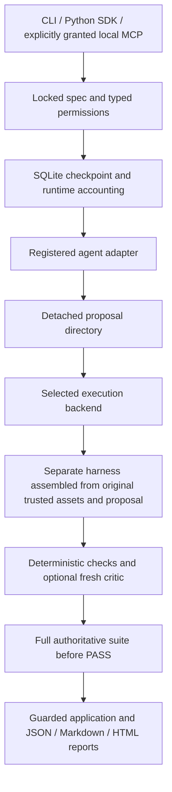

# Universal execution architecture (unreleased)

The current package remains 0.4.0 on the feature branch. Public integration contract version is 1; specification versions 1/2 remain supported. This is not a production certification.

`interfaces.py` defines agent, execution, model-provider, verifier and event protocols. `adapters.py` registers Codex, OpenCode, Claude and custom executable adapters. Core orchestration calls capabilities/command/parse rather than vendor flags. Git preparation is a declared adapter capability; container path mapping belongs to the backend. No vendor SDK, IDE or Docker installation is required for deterministic host verification.

`sdk.run` owns permissions, immutable contract bytes, a run ID, deadline, ledger, events, progress and application. CLI run/verify use this path. Existing `engine.run_loop` remains a compatibility API with the older shared-workspace fingerprint boundary; use `olyder.sdk` for new integrations. Local MCP is read-only by default; a server-side grant exposes `olyder_run`. Clients cannot supply commands or escalate permissions. The optional authenticated loopback HTTP API intentionally exposes only doctor/plan/file verification.

`workspace.py` copies a bounded original source snapshot into private run storage, omitting known credential files, dependency trees and VCS/runtime metadata. The builder receives implementation files without acceptance assets. The harness combines the proposal with the original protected tests and contract. Direct test scripts, unittest module references, declared protected paths and conventional test directories are protected. Missing oracle assets, case-variant replacements, special files, links, snapshot changes and incompatible manifests block execution. Declare custom verifier scripts/data in protected_paths; inference is not semantic discovery of every oracle dependency.

Only the proposal directory is mounted writable for a Docker builder. Command verification uses a different read-only harness mount. Docker has no socket mount, reduced capabilities, resource limits and network none by default. Host execution is explicitly unsafe and cannot protect against a hostile process with the caller's filesystem rights. HTTP/browser checks and trusted Python callbacks execute on the host; reports describe scope. Reviewed images must contain their dependencies. Source application checks for concurrent original edits and validates the resulting file/directory tree. Application is not an atomic multi-file filesystem transaction: an I/O error can leave partial changes, reported as blocked with application_status.

`RuntimeAccounting` connects reviewed per-turn allowances and a protected verifier reserve to execution. `BudgetLedger` transfers reserves atomically, records identity-based requests, persists a versioned checkpoint and distinguishes unknown settlements. Decimal USD amounts are required. Model usage observations are separate from invoices. Pricing snapshots are explicit, dated, provider/model-specific and versioned; configured model identity is labelled requested rather than independently observed. OpenCode cached/reasoning counts are normalized before estimation. No gateway or hard provider enforcement is implemented. strict stops all subsequent paid admission after unknown settlement, including a requested critic; deterministic checks remain available and an unresolved critic stays needs_review. It cannot prevent mid-turn provider charges. The final critic is called only after the full deterministic suite succeeds, preserving its reserve across failed repair attempts. Manual reconciliation requires a user-provided receipt reference and retains that provenance.

`RunStore` uses SQLite transactions, revision checks and synchronous writes. Reservations and the builder-start phase are saved before execution. Crashes in builder/paid-critic phases remain uncertain and are never blindly replayed. Resume rechecks a checkpointed proposal with the original trusted suite; --recover permits interrupted deterministic verification after the operator stops any old process. Requested AI review is not silently re-created or waived. Workspace manifest schema 3 captures directory topology and file permissions; earlier experimental schema-1/2 snapshots are rejected for resume. Specification schemas 1/2, result schema 2 and ledger/run-state schema 1 are distinct contracts.

`analysis.run_analysis` supplies separate checkpointed plan/idea jobs with planner/research-role admissions, deadlines, cancellation and observed/unknown model usage. Pure deterministic planning requires no model. Analysis never claims code verification. Each job/run has its own configured allowance; there is no shared account-wide or cross-run spending limit.

Optional incremental selection uses explicit paths/depends_on declarations, retains failures and dynamic/plugin checks, falls back to full verification for missing/invalid mappings, and runs a fresh full suite before PASS. There is no result cache. Policies affect bounded retry patience and final-check time admission, not acceptance requirements. Check movement, regressions, file footprints and failure signatures are recorded. The reserve is not a promise that every possible suite fits; expired outcomes remain blocked.

Events stream bounded lifecycle and known agent-event metadata, not raw thoughts/prompts/logs. Usage is reconciled after execution. Observer failures are recorded without abandoning process supervision. Cancellation kills process groups/trees best-effort and attempts removal of named containers. SIGKILL, detached host children, trickle-fed HTTP and daemon failures remain resource-containment limits; late outcomes cannot PASS.
